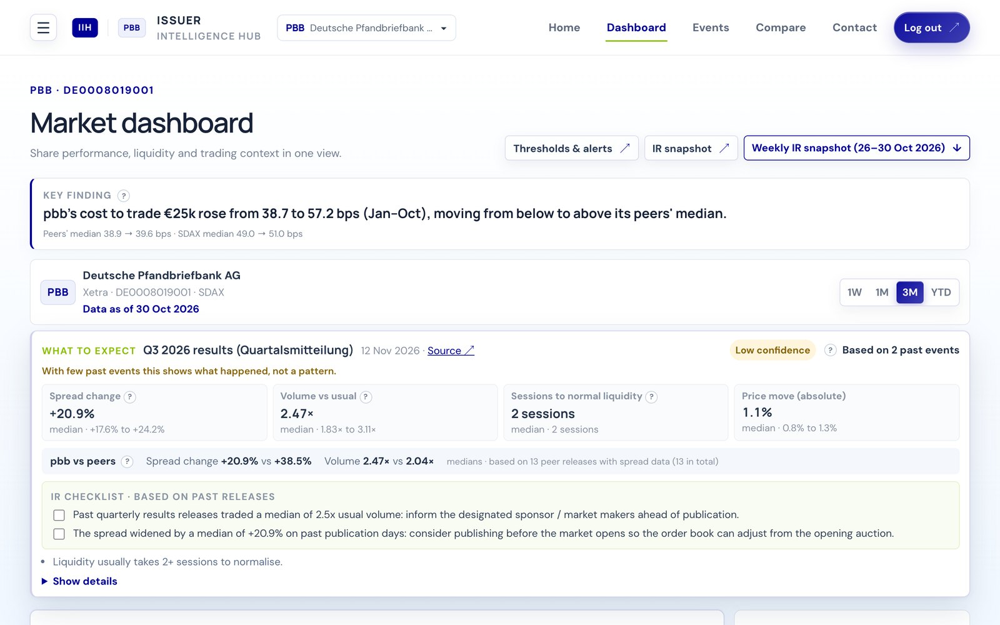
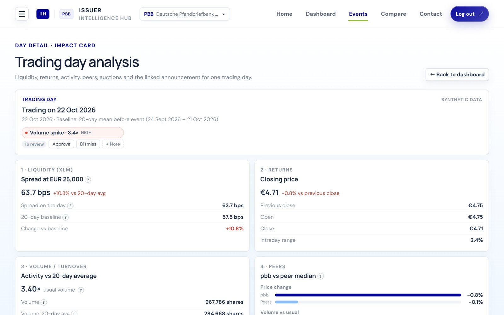
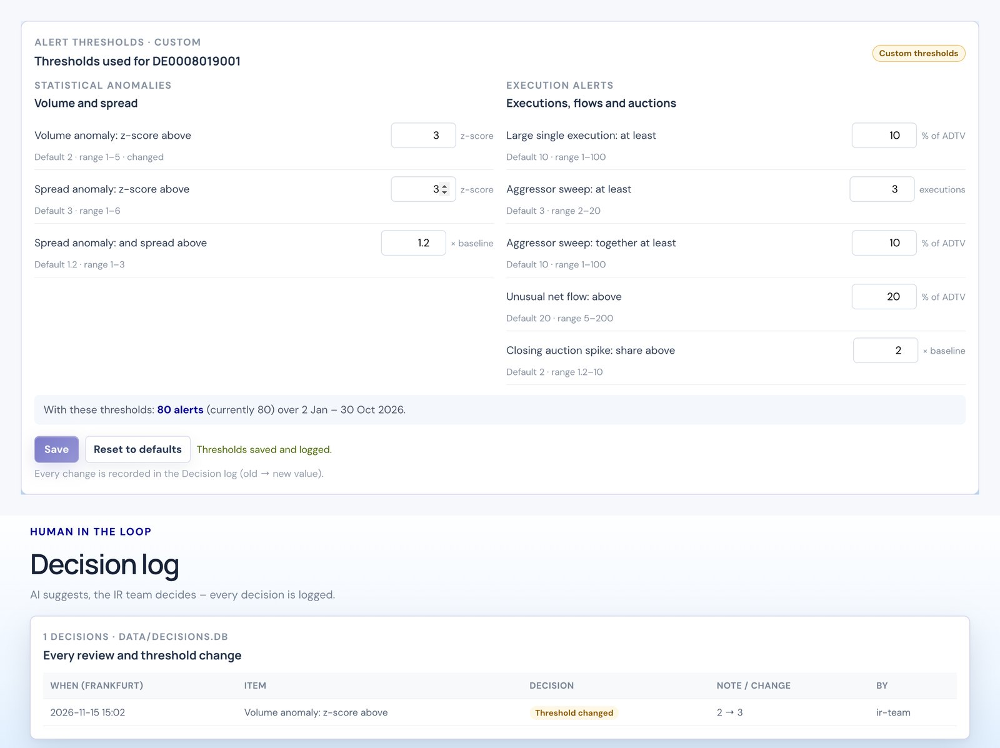

# Issuer Intelligence Hub

A self-service tool for Investor Relations teams of small and mid caps: it explains how their share traded on Xetra (liquidity, spread, auctions, peers) and what happened around each announcement, with short summaries written by an LLM that may only rephrase computed figures.

Built in 2026 at **Futury Build Days** for the **Deutsche Börse challenge**. The demo issuer is Deutsche Pfandbriefbank AG (pbb, SDAX).

> **All figures in the mocks and screenshots of this repository are synthetic.** The Xetra data used during the hackathon is licensed and is not included (see [Data](#data)).


*Screenshots show synthetic data.*

## Team

| | Role |
|---|---|
| Alfred Mushagalusa Munganga ([@alfredlog](https://github.com/alfredlog)) | Analytics & AI assistant |
| Wissem Saadaoui ([@h4ngm4n](https://github.com/h4ngm4n)) | Back-end |
| Yassine Choukairy ([@YassineChoukairy](https://github.com/YassineChoukairy)) | Front-end |
| Rayen Boukari ([@rayen2021](https://github.com/rayen2021)) | Front-end |

## Principles

- **Grounded**: every number comes from the trading data through deterministic code. The LLM receives these facts and may only rephrase them: a guard rejects any text containing a number that is not in the facts, or forecasting and advice vocabulary (buy, sell, target, forecast…). The text then falls back to a template.
- **Explainable**: each metric is a simple rule (20-day baseline, ratio, z-score, peer median) that is documented in the UI (help tooltips) and below. Alerts state the value that triggered them.
- **Human in the loop**: the AI suggests, the IR team decides. Alerts and AI summaries can be approved or dismissed with a note, thresholds can be changed by the team, and every decision is stored in a decision log.

## Features

All of the following exist in the code of this repository:

- **Market dashboard**: price, volume, spread at EUR 25,000 (XLM), auction share, EMA20/EMA50, MACD, support/resistance levels, comparison with peers and with the index, and a *key finding* sentence computed by rules (first month vs last month).
- **Anomaly detection**: volume and spread anomalies, plus execution alerts (large single execution, aggressor sweep, unusual net flow, closing auction spike, notable price move vs peers, level break), ranked by severity then recency.
- **Impact cards** for each announcement or any trading day: metrics vs the 20-day baseline, −5/+5 session window, peers, opening/closing auctions, minute-by-minute intraday reaction, trading in the sessions *before* a voting-rights notification, and an AI summary.
- **What to expect**: how trading reacted to past announcements of the same type (own history and peers), as ranges with a confidence level and an IR preparation checklist. No price prediction.
- **Alerts with Approve / Dismiss / Note**, on anomalies and on AI summaries.
- **Editable thresholds** per issuer, with bounds, a live preview of the resulting number of alerts, and reset to defaults.
- **Decision log** of every review and threshold change.
- **AI assistant chat** grounded in the same analyses (tool use, guard, deterministic fallback), with suggested questions and links to the relevant day or event.
- **PDF export** of impact cards and of the IR snapshot report.
- **Auction share trend**: share of volume executed in auctions with a 20-session average, split into opening, intraday and closing auctions.
- **Multi-issuer**: any DAX, MDAX or SDAX issuer can be selected (`?isin=` in the URL); issuers without a manual peer list are compared with the members of their index on each date.


*Screenshots show synthetic data.*


*Screenshots show synthetic data.*

## Architecture

```
data/raw (Xetra files)  ──or──  app/etl/synthetic.py (when data/raw is absent)
          │
          ▼
app/etl          load XLM spreads, OHLC, flows, trades, index constituents, events → pandas DataFrames
          │
          ▼
app/analytics    metrics, baselines, anomalies, alerts, peers, indicators, impact cards, previews, report
          │
          ▼
app/api          FastAPI routes + Pydantic schemas (token auth, CORS)  ──►  app/export (PDF, reportlab)
          │  HTTP/JSON
          ▼
bourse-dashboard React + TypeScript front-end (Vite)
```

AI text pipeline (`app/assistant`):

```
facts computed by analytics ──► LLM (rephrase only) ──► guard ──ok──► text
                                                          │
                                                          └─fail / no key / error──► template text
```

The guard (`app/assistant/guard.py`) checks that every number in the LLM text exists in the facts and that no forbidden word is used. Without an API key, or if the LLM fails, the API returns the template text: it never fails because of the LLM.

## Methodology

Thresholds below are the defaults in the code (`app/config.py`, `app/analytics/thresholds.py`, `app/analytics/metrics.py`); the IR team can change most of them in the app.

| Item | Rule |
|---|---|
| Spread | XLM `Impact_bps` for a EUR 25,000 round trip |
| Baseline | mean of the 20 previous trading days (measured day excluded) |
| Ratio | value ÷ baseline (e.g. `volume_ratio`) |
| z-score | (value − 20-day mean) ÷ 20-day standard deviation |
| Auction share | volume executed in auctions ÷ total volume |
| Volume anomaly | z > 2 → medium, z > 3 → high |
| Spread anomaly | z > 3 **and** spread > 1.2 × baseline; high if z > 4 or spread > 1.5 × baseline |
| Large execution | single execution ≥ 10 % of the 30-day average daily turnover (ADTV) |
| Aggressor sweep | ≥ 3 consecutive executions on the same side within 1 s, together ≥ 10 % of ADTV |
| Net flow | net AGENT or PROP flow > 20 % of ADTV |
| Closing auction spike | closing auction share > 2 × its 20-day baseline |
| Notable price move | excess return vs peer median > 2.5 % and volume > 1.5 × usual |
| Event trading day | announcement before 17:30 (Frankfurt) → same day, otherwise next trading day |
| Event window | trading days −5 to +5 around the event trading day |
| Peers | manual list for pbb (`config.PEERS`); other issuers: members of the same index on that date |
| "What to expect" confidence | low if n < 3 past events, medium 3–5, high > 5 |
| Indicators | EMA20, EMA50, MACD (12, 26, 9), support/resistance from local pivots |

## Stack

- Back-end: Python 3.11, FastAPI, Pydantic v2, pandas, numpy, reportlab, Anthropic or OpenAI SDK, pytest
- Front-end: React 19, TypeScript, Vite, Tailwind CSS, Recharts, lightweight-charts, oxlint

## Getting started

### Back-end

```bash
python -m venv .venv
source .venv/bin/activate        # Windows: .venv\Scripts\activate
pip install -r requirements.txt
cp .env.example .env             # set APP_PASSWORD and SESSION_SECRET; LLM_API_KEY is optional
uvicorn app.main:app --reload --port 8000
```

API docs: `http://localhost:8000/docs`. Without `data/raw`, the API logs `serving SYNTHETIC market data` and starts in about 10 seconds.

### Front-end

```bash
cd bourse-dashboard
npm install
npm run dev                      # http://localhost:5173, /api is proxied to http://localhost:8000
```

Log in with the `APP_PASSWORD` you set in `.env`.

### Environment variables

Back-end (`.env.example`):

| Variable | Purpose |
|---|---|
| `DATA_DIR`, `PROCESSED_DIR`, `EVENTS_CSV` | locations of the Xetra files, extracted trades and announcement calendar |
| `SYNTHETIC_DATA` | `auto` (default): synthetic data when `DATA_DIR` has no Xetra files · `on` · `off` |
| `DECISIONS_DB` | SQLite file for the decision log and custom thresholds (default `data/decisions.db`) |
| `LLM_PROVIDER`, `LLM_API_KEY`, `LLM_MODEL`, `LLM_TIMEOUT_S` | optional LLM; empty key = template texts only |
| `FRONTEND_ORIGIN` | origins allowed by CORS (comma-separated) |
| `APP_PASSWORD`, `SESSION_SECRET` | team login and token signing key |

Front-end (`bourse-dashboard/.env.example`): `VITE_API_URL`, and `API_TARGET` / `API_AUTH` for the development proxy.

### Tests

```bash
pytest                           # back-end; tests that need the real Xetra files are skipped without them
cd bourse-dashboard && npm run build && npm run lint
```

## Data

The Xetra data provided for the challenge (Deutsche Börse) is licensed and is **not** in this repository. `data/raw/` and `data/processed/` are ignored by git.

Expected layout if you have access to the files:

```
data/raw/
├── spreads/dax_mdax_sdax_xlm.YYYYMMDD.csv
├── index_constituents/{DAX,MDAX,SDAX}_CONSTITUENTS_YYYYMMDD.csv.gz
└── XETRA/
    ├── XETRA_OHLC/XETRA_OHLC_YYYYMMDD.csv.gz
    ├── XETRA_FLOW_DYNAMICS_EQUITY/XETRA_FLOW_DYNAMICS_EQUITY_YYYYMMDD.csv.gz
    └── XETRA_ONBOOK_TRADES/XETRA_ONBOOK_TRADES_YYYYMMDD.csv.gz
```

Then run `python -m scripts.extract_trades` once to build `data/processed/trades_<ISIN>.csv.gz` for the demo issuer and its peers.

**Without these files, the app still runs**: `app/etl/synthetic.py` generates a synthetic market (random-walk prices, volumes, spreads, flows and trades, fixed seed) and the real analytics run on it. The JSON files in `mocks/` are exactly what the API returns in this mode; regenerate them with `python -m scripts.make_synthetic_mocks`. Only `data/events.csv` (public announcement dates and titles) is real.

## Limitations

- The data covers about 10 months (2 January to 30 October 2026), so the 20-day baselines and the event history are short.
- "What to expect" relies on few past events of each type (often n = 2 for pbb): it shows what happened, not a pattern. The confidence label says so.
- The announcement calendar (`data/events.csv`) is filled by hand: pbb's 2026 announcements plus the 2026 quarterly results of its six peers. Other issuers have no announcements loaded.
- Flows and trades describe executions, not investors: the tool never says who traded.
- This is a hackathon prototype: one shared team password, no user management, SQLite storage.

## Disclaimers

*Descriptive analysis of historical Xetra trading data. Not investment advice.*

*Hackathon prototype. Not affiliated with or endorsed by Deutsche Börse AG or Deutsche Pfandbriefbank AG.*

## License

[MIT](LICENSE)
